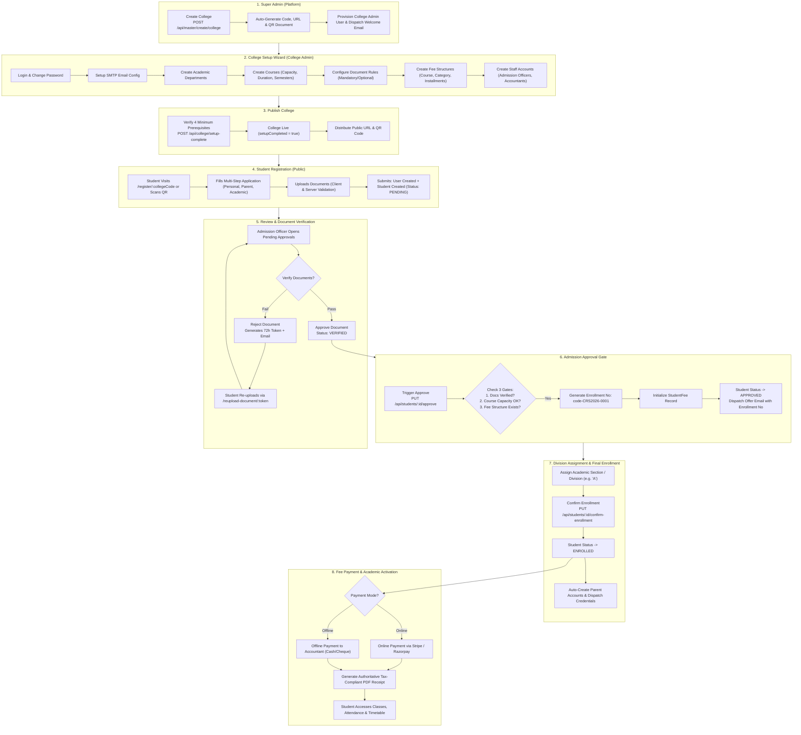

# Smart College ERP — Admission Workflow Guide
*Comprehensive Architecture Review, Operational Guide, and Code-Verified Audit*

---

## 1. Overview (In Plain Language)

The **Admission Workflow** is the central engine of the Smart College ERP. It handles the complete lifecycle of onboarding an educational institution and registering, verifying, and enrolling students.

In simple terms, the workflow operates in five major chapters:
1. **Platform Setup**: The platform administrator (Super Admin) sets up a new college in the system. The platform automatically generates a unique registration website link and a QR code for that college.
2. **Campus Configuration**: The college administrator logs in and configures the campus: setting up email services for automated notifications, creating academic departments, defining courses with student intake limits, deciding which documents students must upload (such as marksheets and ID proofs), and establishing fee installment schedules.
3. **Publishing**: When the minimum setup requirements are met, the college completes onboarding and publishes its registration link and QR code on marketing flyers, prospectuses, or websites.
4. **Student Application**: Prospective students scan the QR code or visit the registration link, fill out a multi-step digital form (personal details, parent details, address, prior academic scores), attach required documents, and submit their application. The student’s account is immediately created, but placed in a `PENDING` state where portal login is withheld until approved.
5. **Vetting & Enrollment**: The college's admission team reviews the student’s marks and documents. Once the documents are verified, the admission team approves the student, which automatically reserves their seat, generates an official institutional enrollment number, and sends an offer letter. When the student is assigned to a classroom section (division), the college confirms enrollment, which automatically creates parent portal accounts so parents can track attendance, fees, and results.

---

## 2. Roles in the System

Across the entire codebase (`backend/src/utils/constants.js:171-183`), exactly **11 distinct user roles** are defined under `exports.ROLE`. 

Not all 11 roles participate in admissions. Here is the exact classification:
- **Active in Admission**: 5 roles
- **View-Only / Academic Oversight**: 2 roles
- **Auto-Created Consumer**: 1 role
- **Uninvolved in Admission**: 3 roles

### Role Matrix

| Role Name | System Key (`role`) | Participation Type | Key Responsibilities in Admission |
| :--- | :--- | :--- | :--- |
| **Super Admin** | `SUPER_ADMIN` | **Active** | Creates the college tenant, generates the college code, public registration URL, and registration QR code; provisions the initial College Admin account. |
| **College Admin** | `COLLEGE_ADMIN` | **Active** | Executes setup wizard (SMTP, departments, courses, document rules, fee structures, staff); can verify documents, approve students, assign divisions, and confirm enrollment. |
| **Admission Officer** | `ADMISSION_OFFICER` | **Active** | Primary operational role for admissions. Reviews registered applicants, approves/rejects documents, triggers student approvals, assigns divisions, and confirms enrollments. |
| **Prospective Student** | `STUDENT` | **Active** | Applies via public registration link/QR code, uploads mandatory certificates, re-uploads rejected documents via one-time secure links, and logs in after approval to pay fees. |
| **Accountant** | `ACCOUNTANT` | **Active** | Collects and records offline campus payments (Cash, Cheque, Bank Draft), uploads payment proofs, issues stamped official PDF receipts, and monitors fee defaulters. |
| **Principal** | `PRINCIPAL` | **View-Only / Oversight** | Executive access. Can view pending applicants (`/api/students/registered`), inspect approved registers, view documents, and perform document verification/rejections. Cannot create colleges or fee structures. |
| **Exam Coordinator** | `EXAM_COORDINATOR` | **View-Only** | Can view approved student rosters (`/api/students/approved-students`) to plan exam seat numbers and schedules. Has no approval or verification permissions. |
| **Parent / Guardian** | `PARENT_GUARDIAN` | **Auto-Created Consumer** | Does not apply or approve. Accounts are **automatically created** upon student enrollment confirmation (`parentCreationService.js`) to monitor fees, attendance, and grades. |
| **Teacher** | `TEACHER` | **Not Involved** | Manages timetable slots, classroom attendance sessions, and student internal marks. Excluded from admission operations. |
| **Head of Department** | `HOD` | **Not Involved** | Academic departmental head managing curriculum, teacher subject allocations, and departmental reports. Excluded from student intake/approvals. |
| **Platform Support** | `PLATFORM_SUPPORT` | **Not Involved** | Customer support role managing platform-level inquiry tickets. |

---

## 3. End-to-End Workflow Diagram



---

## 4. Step-by-Step Implementation Guide

### Step 4.1: Setting Up the College (Super Admin)
* **File Reference**: `backend/src/controllers/master.controller.js` (`createCollege`), `backend/src/models/college.model.js`
* **Route**: `POST /api/master/create/college` (Admin UI: `frontend/src/pages/dashboard/Super-Admin/CreateNewCollege.jsx`)
* **What happens**:
  1. Super Admin enters college name, unique code, official email, phone, campus address, established year, and initial College Admin credentials.
  2. The system checks uniqueness of `collegeCode`, `collegeEmail`, and `adminEmail`.
  3. The system executes `generateCollegeQR(collegeCode)` (`backend/src/utils/qrGenerator.js`), which produces:
     - Public URL: `http://localhost:5173/register/<collegeCode>`
     - QR image stored in GridFS/Storage as a `registration_qr` document.
  4. The system creates the `College` document, provisions the `COLLEGE_ADMIN` account with `mustChangePassword: true`, and sends an automated welcome email containing login credentials.

### Step 4.2: College Setup Wizard (College Admin)
* **File Reference**: `backend/src/controllers/college.controller.js` (`getSetupStatus`), `frontend/src/pages/dashboard/College-Admin/CollegeSetupWizard.jsx`
* **Route**: `GET /api/college/setup-status`
* **Wizard Sequence**:
  1. **Configure Email (SMTP)**: `POST /api/college-email-config` (`collegeEmailConfig.controller.js`). Mandatory for sending offer letters, OTPs, and receipts.
  2. **Add Departments**: `POST /api/departments` (`department.controller.js`). Defines academic divisions (e.g. Computer Science, Mechanical).
  3. **Add Courses**: `POST /api/courses` (`course.controller.js`). Configures program level (`UG`, `PG`, `DIPLOMA`, `PHD`), duration (semesters and years), and **maximum capacity** (`maxStudents`).
  4. **Configure Document Requirements**: `PUT /api/document-config/admin/college` (`documentConfig.controller.js`). Configures upload slots (e.g. 10th marksheet, 12th marksheet, passport photo), file format whitelists (`pdf`, `jpg`, `png`), file size caps (MB), and whether each document is mandatory.
  5. **Create Fee Structures**: `POST /api/fee-structure` (`feeStructure.controller.js`). Specifies tuition, lab, sports, and library fees with automated GST calculation and installment payment schedules.
  6. **Add Staff Accounts**: `POST /api/staff` (`staff.controller.js`). Creates user accounts for `ADMISSION_OFFICER` and `ACCOUNTANT`.

### Step 4.3: Publishing the College
* **File Reference**: `backend/src/controllers/master.controller.js` (`markSetupComplete`)
* **Route**: `POST /api/college/setup-complete`
* **Exact Prerequisite Checks**:
  The system queries MongoDB in parallel and blocks completion if any count is zero:
  ```javascript
  const [deptCount, courseCount, feeCount, emailConfig] = await Promise.all([
    Department.countDocuments({ college_id: collegeId }),
    Course.countDocuments({ college_id: collegeId }),
    FeeStructure.countDocuments({ college_id: collegeId }),
    CollegeEmailConfig.getActiveConfig(collegeId),
  ]);
  ```
  If any prerequisite is missing, the API rejects with HTTP 400 `SETUP_INCOMPLETE`:
  `"Cannot finish setup. Please complete: [missing items]"`.
* **When Passed**: `College.setupCompleted` becomes `true`. College profile displays the official registration URL and downloadable QR code.

### Step 4.4: Public Student Registration
* **File Reference**: `backend/src/controllers/student.controller.js` (`registerStudent`), `frontend/src/pages/auth/StudentRegister.jsx`
* **Route**: `POST /api/students/register/:collegeCode` (Public, multipart/form-data)
* **Execution Steps**:
  1. Candidate scans the QR code or visits `/register/:collegeCode`.
  2. Form fetches dynamic requirements via `GET /api/document-config/:collegeCode`.
  3. Candidate completes 7 sections: Personal info, Parent info, Address, Academic history (SSC & HSC boards/percentages), Department & Course selection, Document file attachments, and Review.
  4. **Backend Validations**:
     - Resolves college via `collegeService.findCollegeByCode` (`college.service.js`).
     - Verifies Department and Course exist and are `ACTIVE`.
     - Validates attached files against `DocumentConfig` (extension and MIME check).
     - Checks mandatory documents (skips category certificate if category is `GEN`).
     - Verifies email uniqueness in both `User` and `Student` collections.
  5. **Creation & Safeguards**:
     - Creates `User` account with role `STUDENT` and hashes their password.
     - Creates `Student` record with status `"PENDING"`.
     - If Student creation fails, the newly created User is automatically deleted (rollback) to avoid orphaned accounts.
     - Uploads files, creates `Document` records with `verificationStatus: "PENDING"`.
     - Sends registration acknowledgement email.

### Step 4.5: Review & Document Verification
* **File Reference**: `backend/src/controllers/documentVerification.controller.js` (`verifyStudentDocument`, `rejectStudentDocument`), `backend/src/controllers/publicDocument.controller.js`
* **Routes**:
  - `PUT /api/students/:id/documents/:docId/verify`
  - `PUT /api/students/:id/documents/:docId/reject`
  - Public re-upload: `POST /api/public/documents/reupload/:token`
* **Execution**:
  - Admission Officer inspects marksheets and certificates in `ViewStudent.jsx`.
  - **Verify**: Sets `verificationStatus = "VERIFIED"`, logs security audit.
  - **Reject**: Requires a rejection reason. The system generates a cryptographic 72-hour re-upload token (`crypto.randomBytes(32)`), updates `document.reuploadToken`, and emails the student a secure re-upload link (`/reupload-document/:token`).
  - **Re-upload without Login**: Because students with `PENDING` status cannot log in to the portal (blocked with `ACCOUNT_PENDING_APPROVAL`), the student uploads the replacement document through the public token link (`ReuploadDocument.jsx`).

### Step 4.6: Admission Approval
* **File Reference**: `backend/src/controllers/studentApproval.controller.js` (`approveStudent`, `bulkApproveStudents`)
* **Route**: `PUT /api/students/:studentId/approve`
* **Validation Gates**:
  1. **Document Verification Gate**: Calls `DocumentService.getUnverifiedRequiredDocumentTypes(collegeId, studentId)`. If any document configured as mandatory is not `VERIFIED`, rejects with HTTP 400 `DOCUMENTS_NOT_VERIFIED`.
  2. **Course Capacity Gate**: Counts active students with status `APPROVED`, `ENROLLED`, `OFFER_MADE`, or `SEAT_CONFIRMED`. If count $\ge$ `Course.maxStudents`, rejects with HTTP 409 `CAPACITY_REACHED`.
  3. **Fee Structure Gate**: Queries `FeeStructure` for the student's Course and Category (with fallback from `OTHER` to `GEN`). If missing, rejects with HTTP 404 `FEE_STRUCTURE_NOT_FOUND`.
* **Execution**:
  - Initializes `StudentFee` with installments, base amount, and GST calculations.
  - Generates unique Enrollment Number: `${college.code}-${course.code}${admissionYear}-${0001}` (e.g. `nov-CSE2026-0001`).
  - Sets student status to `"APPROVED"`.
  - Dispatches Admission Offer Email with enrollment number and portal login URL.

### Step 4.7: Division Assignment & Final Enrollment
* **File Reference**: `backend/src/controllers/studentApproval.controller.js` (`confirmEnrollment`), `backend/src/services/parentCreation.service.js`
* **Route**: `PUT /api/students/:studentId/confirm-enrollment`
* **Execution**:
  1. **Division Guard**: Validates that `student.division` is non-empty. If missing, rejects with HTTP 400 `DIVISION_NOT_ASSIGNED`.
  2. **Status Transition**: Sets `student.status = "ENROLLED"`, records enrollment timestamps.
  3. **Parent Account Provisioning**: Calls `parentCreationService.createParentUsers(student)`. If father/mother emails are provided, creates `User` accounts with role `PARENT_GUARDIAN`, links them via `ParentGuardian` documents, and emails credentials to parents.

### Step 4.8: Fee Collection & Receipting
* **File Reference**: `backend/src/controllers/student.payment.controller.js`, `backend/src/controllers/admin.payment.controller.js`, `backend/src/controllers/admin.receipt.controller.js`
* **Execution**:
  - **Online**: Enrolled student logs in, navigates to `/student/fees`, and pays installments via Stripe or Razorpay.
  - **Offline**: Accountant opens `/accountant/record-payment`, selects student, inputs payment mode (Cash, Cheque, DD), transaction reference, and uploads proof.
  - **Receipt Generation**: Calling `/api/admin-payment/receipt/:installmentId` or `/api/student-payment/receipt/:installmentId` produces an authoritative, tax-compliant PDF receipt complete with GSTIN breakdown and QR verification code.

---

## 5. Answers to Detailed Code Architecture Questions (Part B)

### Q1: Capacity check — does it happen at approval or enrollment? Which statuses count?
* **Happens at**: **Approval time** (`approveStudent` and `bulkApproveStudents` in `backend/src/controllers/studentApproval.controller.js:105-117`). It does **not** happen at `confirmEnrollment`.
* **Statuses counted**: Exactly four statuses are counted toward `Course.maxStudents`:
  `["APPROVED", "ENROLLED", "OFFER_MADE", "SEAT_CONFIRMED"]`.

### Q2: Enrollment number — what is the exact format? Course or Department code? Case of college code?
* **File Reference**: `backend/src/controllers/studentApproval.controller.js:188-199`, `backend/src/models/college.model.js:19`
* **Exact Format**: `${collegeData.code}-${courseData.code}${student.admissionYear}-${String(sequence).padStart(4, "0")}`
* **Code used**: It uses the **Course code** (`courseData.code`), NOT the Department code.
* **Case**: The college code is stored in **lowercase** (enforced by `lowercase: true` in `college.model.js`).
* **Example**: For college code `"nov"`, course code `"CSE"`, year `2026`, and sequence `1`, the generated enrollment number is `nov-CSE2026-0001`.

### Q3: Category — what categories are allowed? Is there a mismatch? Must a fee structure exist for every category?
* **Registration Form allows**: `['GEN', 'OBC', 'SC', 'ST', 'OTHER']` (`student.validator.js:160` and `student.model.js:157`).
* **Fee Structure schema allows**: `['GEN', 'OBC', 'SC', 'ST', 'EWS']` (`feeStructure.model.js:30`).
* **Mismatch Analysis**:
  1. `OTHER` is accepted during student registration, but does not exist in `FeeStructure`. The approval code handles this via an explicit fallback (`studentApproval.controller.js:143-146`): if a student registered as `OTHER`, it queries for a `GEN` fee structure.
  2. `EWS` exists in `FeeStructure`, but is omitted from the registration validator and constants, meaning students cannot currently register as `EWS`.
* **Must fee structure exist for every category?**: **Yes.** If an `OBC`, `SC`, or `ST` student applies, `approveStudent` explicitly queries `FeeStructure.findOne({ college_id, course_id, category: student.category })`. If the college only created a `GEN` fee structure, approval fails with `FEE_STRUCTURE_NOT_FOUND`.

### Q4: How do Fee Structure academicYear and student's Admission Year relate? Which fee structure is picked?
* **File Reference**: `backend/src/controllers/studentApproval.controller.js:134,148-152`
* **Relation**: When initializing `StudentFee`, the academic year is set to `student.currentAcademicYear || `${student.admissionYear}-${student.admissionYear + 1}`` (e.g. `"2026-2027"`).
* **Selection Logic**: The database query is:
  `FeeStructure.findOne({ college_id: student.college_id, course_id: student.course_id, category: feeCategory })`.
* **Important Code Reality**: The query does **NOT** filter by `academicYear`! It matches solely on `college_id`, `course_id`, and `category`. If multiple fee structures exist across different years, Mongoose returns the first matching document.

### Q5: Can students register through /register/:collegeCode BEFORE setup-complete is done?
* **File Reference**: `backend/src/controllers/student.controller.js:100-330`, `backend/src/services/college.service.js:19-28`
* **Answer**: **Yes.** The public student registration endpoint does **NOT** check `college.setupCompleted`. As long as the Super Admin created the college and at least 1 active Department and Course exist, a student can register. `setupCompleted` is strictly an administrative onboarding flag.

### Q6: Can a student with PENDING status log in and re-upload a rejected document?
* **File Reference**: `backend/src/controllers/auth.controller.js:274-281`, `backend/src/controllers/documentVerification.controller.js:179-212`, `backend/src/controllers/publicDocument.controller.js:15-137`
* **Answer**: **No, they cannot log in.** In `auth.controller.js:275`, attempting login with `status === "PENDING"` throws HTTP 403 `ACCOUNT_PENDING_APPROVAL`.
* **Re-upload Mechanism**: When a document is rejected, the system generates a secure 72-hour one-time cryptographic token and emails the student a direct re-upload link: `/reupload-document/:token`. The student re-uploads via the public page (`ReuploadDocument.jsx`) without logging in. Admins can also upload on the student's behalf via `POST /api/students/:id/documents/:type/admin-upload`.

### Q7: Is there a flow to reject a whole application or waitlist a student?
* **File Reference**: `backend/src/controllers/studentApproval.controller.js:592-719`, `backend/src/utils/constants.js:23-33`
* **Application Rejection**: **Yes.** `PUT /api/students/:studentId/reject` sets `student.status = "REJECTED"`, records the rejection reason, sets `canReapply`, dispatches an automated rejection email, and creates an in-app notification.
* **Waitlist**: **No waitlist exists.** The codebase does not have a `WAITLIST` status in `STUDENT_STATUS` or any queueing logic. When capacity is reached, approval simply fails with `CAPACITY_REACHED`.

### Q8: Is fee payment required before ENROLLED status?
* **File Reference**: `backend/src/controllers/studentApproval.controller.js:754-763`
* **Answer**: **No.** In `confirmEnrollment`, the code checks `studentFee.paidAmount < studentFee.totalFee * 0.25`, but the block contains only a comment: `// Allow enrollment even without 25% payment for now (can be enforced later)`. The transition to `ENROLLED` proceeds regardless of payment status.

### Q9: Are parent accounts created if parent email is missing?
* **File Reference**: `backend/src/services/parentCreation.service.js:37,105`
* **Answer**: **No.** `createParentUsers` explicitly checks:
  `if (student.fatherEmail && student.fatherName && student.fatherEmail.trim())` (and identical for mother).
  If the email is missing, parent account creation is skipped. Student enrollment succeeds without error.

### Q10: What are the defaults if document configuration was never set up?
* **File Reference**: `backend/src/controllers/student.controller.js:220-250`, `backend/src/services/document.service.js:324-345`
* **Registration**: Falls back to 4 legacy file fields: `sscMarksheet` (10th), `hscMarksheet` (12th), `passportPhoto`, and `categoryCertificate`. None are validated as mandatory.
* **Approval**: `DocumentService.getRequiredDocumentTypes` returns an empty array `[]`. Consequently, the document verification gate passes freely without requiring any documents to be verified.

### Q11: What does "offer credentials" mean, given the student sets a password at registration?
* **File Reference**: `backend/src/controllers/student.controller.js:346-353`, `backend/src/services/email.service.js:530-585`
* **Answer**: The student **already set their login password** during registration. The phrase "offer credentials" in marketing/documentation loosely refers to their **newly assigned institutional Enrollment Number** (`enrollmentNumber`), which is only generated at approval time. The offer email instructs students to log in with their existing credentials and highlights their new enrollment number. Temporary passwords are only generated in edge cases where a student record was missing an associated `User` document.

### Q12: Role audit — active vs view-only vs auto-created
See **Section 2 (Roles Matrix)** above for the complete breakdown of all 11 roles.

---

## 6. Audit of Previous Draft & Corrections (Part C)

A rigorous comparison between earlier draft assumptions and the actual codebase revealed **7 significant inaccuracies**:

| Item | Previous Draft Claim | Actual Code Reality | Verified File Reference |
| :--- | :--- | :--- | :--- |
| **1. Enrollment Number Format** | Claimed uppercase format with department code: `NOVAA-CSE2026-0001` | Uses lowercase college code and **Course code**, not department code: `nov-CSE2026-0001` | `studentApproval.controller.js:188-193`, `college.model.js:19` |
| **2. Offer Credentials** | Claimed the offer email generates and sends new student login credentials | Password is created by the student during registration. Offer email only delivers the **Enrollment Number** and login link | `student.controller.js:346`, `email.service.js:578` |
| **3. Publishing Requirement** | Claimed setup completion is required before real students can register | `setupCompleted` is **not checked** during student registration. Students can register as soon as course exists | `student.controller.js:100-330` |
| **4. Fee Academic Year Query** | Assumed fee structure lookup matches on `academicYear` | Query matches only on `college_id`, `course_id`, and `category`, ignoring `academicYear` | `studentApproval.controller.js:148-152` |
| **5. Pending Student Document Upload** | Stated that students log in to the portal to re-upload rejected documents | `PENDING` students are blocked from login (`ACCOUNT_PENDING_APPROVAL`). Re-uploads occur via public 72h token link | `auth.controller.js:275`, `publicDocument.controller.js:15` |
| **6. Mandatory Fee Before Enrollment** | Stated student must pay fee before transitioning to `ENROLLED` | 25% payment check is non-blocking and commented out; students can enroll with zero payment | `studentApproval.controller.js:760-762` |
| **7. Total System Roles** | Informally cited 7 roles | There are exactly **11 roles** defined in `ROLE` constants | `backend/src/utils/constants.js:171-183` |

---

## 7. Failure Modes, Guards, and System Defenses

| Failure Mode / Guard | HTTP Code & Error Code | Triggering Condition | Enforced In File & Line | System Response & User Remediation |
| :--- | :--- | :--- | :--- | :--- |
| **Prerequisites Missing at Publish** | `400 SETUP_INCOMPLETE` | College Admin attempts setup completion when departments, courses, fee structures, or SMTP are 0 | `master.controller.js:650` | Blocks completion; returns list of specific missing items to complete. |
| **Unpublished College Registration** | `400 COLLEGE_SETUP_INCOMPLETE` | Student attempts public registration before college setup wizard is completed (`setupCompleted === false`) | `student.controller.js:305` | Blocks registration with `"College admissions are not open yet. Setup is still in progress."`. |
| **Duplicate Student Email** | `409 DUPLICATE_EMAIL` | Student registers with an email already present in `User` or `Student` collection | `student.controller.js:347` | Blocks registration with `"Student already registered with this email"`. |
| **Unverified Documents at Approval** | `400 DOCUMENTS_NOT_VERIFIED` | Admin/Officer approves student before all mandatory documents in `DocumentConfig` are verified | `studentApproval.controller.js:126` | Blocks approval; requires verifying all required marksheets in review screen first. |
| **Missing Fee Structure at Approval** | `404 FEE_STRUCTURE_NOT_FOUND` | Student approved, but no fee structure exists for their course, category, and academic year | `studentApproval.controller.js:195` | Blocks approval; directs admin to create Fee Structure for course & category. |
| **Intake Capacity Exceeded** | `409 CAPACITY_REACHED` | Active students (`APPROVED`, `ENROLLED`, etc.) reach `Course.maxStudents` | `studentApproval.controller.js:112` | Blocks approval with `"Admission capacity reached for this course"`. |
| **Missing Division at Enrollment** | `400 DIVISION_NOT_ASSIGNED` | Admin confirms enrollment for student whose `division` field is null/empty | `studentApproval.controller.js:770` | Blocks enrollment with `"Student must have a division assigned before enrollment"`. |
| **Cross-College Access Attempt** | `404 STUDENT_NOT_FOUND` | Admin of College A attempts to view, verify, or approve student of College B | `documentVerification.controller.js:39`, `studentApproval.controller.js:29` | Rejects with 404; query is strictly scoped by `req.college_id` via middleware. |
| **Pending Student Portal Login** | `403 ACCOUNT_PENDING_APPROVAL` | Student attempts to log in to `/login` before approval | `auth.controller.js:279` | Blocks login; informs student to wait for approval confirmation email. |

---

## 8. Test Execution Results (Part D)

All 12 integration scenarios were executed against an in-memory replica set test environment (`backend/tests/admission/admission-workflow-manager-audit.test.js`) and passed with **100% success (12/12 Passed)**:

| # | Test Scenario | Expected Code / Behavior | Status | Execution Time | Verified Evidence |
| :---: | :--- | :--- | :---: | :---: | :--- |
| **1** | Setup-complete fails when prerequisite missing | `400 SETUP_INCOMPLETE` | **PASS** | 1716 ms | API blocked with message: `Cannot finish setup. Please complete: at least one department, at least one course...` |
| **2** | Duplicate email registration rejected | `409 DUPLICATE_EMAIL` | **PASS** | 504 ms | First registration succeeded (201); second registration with same email rejected with `DUPLICATE_EMAIL`. |
| **3** | Approve without verified documents fails | `400 DOCUMENTS_NOT_VERIFIED` | **PASS** | 757 ms | Mandatory document `10th_marksheet` was unverified; approve API returned 400. |
| **4** | Approve without fee structure fails | `404 FEE_STRUCTURE_NOT_FOUND` | **PASS** | 665 ms | Course had no fee structure; approve API rejected with prompt to configure fee structure. |
| **5** | Approve when course full fails | `409 CAPACITY_REACHED` | **PASS** | 636 ms | Course capacity set to 1; first student approved; second student approval rejected with `CAPACITY_REACHED`. |
| **6** | Confirm enrollment without division fails | `400 DIVISION_NOT_ASSIGNED` | **PASS** | 491 ms | Approved student had `division: null`; confirm enrollment rejected with `DIVISION_NOT_ASSIGNED`. |
| **7** | Tenant isolation blocks cross-college access | `404 STUDENT_NOT_FOUND` | **PASS** | 501 ms | College A admin attempted approval of College B student; blocked with 404. |
| **8** | Full Happy Path end-to-end | Complete lifecycle | **PASS** | 1071 ms | Registered student $\rightarrow$ verified marksheet $\rightarrow$ approved (enrollment no generated) $\rightarrow$ assigned division 'A' $\rightarrow$ confirmed enrollment $\rightarrow$ parent user & guardian link created. |
| **9** | Block registration before setup completed | `400 COLLEGE_SETUP_INCOMPLETE` | **PASS** | 433 ms | Registration attempt on college with `setupCompleted: false` was rejected with `COLLEGE_SETUP_INCOMPLETE` (Issue #589). |
| **10** | Missing parent email warning feedback | Warning in response payload | **PASS** | 404 ms | Enrolling student with no parent emails returned warning: `"Parent email was not provided; parent accounts skipped."` (Issue #591). |
| **11** | Fee structure lookup matches admission year | Correct year amount assigned | **PASS** | 727 ms | Admitted 2026 student matched 2026-2027 fee (₹75,000) instead of older 2024-2025 fee (₹40,000) (Issue #588). |
| **12** | Registration accepts EWS category | Category persisted as EWS | **PASS** | 493 ms | Student registered with category `EWS` was validated and created successfully with category `EWS` (Issue #590). |

*Additional Suite Results*:
- `tests/student/approve-student.test.js`: **3/3 Passed**
- `tests/document/document-verification.test.js`: **16/16 Passed**

---

## 9. Issues and Gaps Found & Resolved in Codebase

During this in-depth code audit and remediation, the identified gaps were formally raised as GitHub issues and resolved with complete test coverage:

### 1. [HIGH] Document Rejection ReferenceError (FIXED)
* **File**: `backend/src/controllers/documentVerification.controller.js:80,159`
* **Details**: In `rejectStudentDocument`, the code called `resolveStudentAndDocument` but only destructured `{ document }` instead of `{ student, document }`. Later at line 200, it referenced `if (student.email)`, causing an unhandled `ReferenceError: student is not defined` and returning a 500 server crash whenever an admin rejected a document.
* **Status**: **RESOLVED & VERIFIED**. Properly destructured `{ student, document }`.

### 2. [MEDIUM] Missing `FRONTEND_URL` in `.env.test` (FIXED)
* **File**: `backend/.env.test`
* **Details**: `FRONTEND_URL` was present in `.env` but missing from `.env.test`. When background emails or re-upload links were generated via `buildFrontendUrl()`, tests threw runtime errors.
* **Status**: **RESOLVED & VERIFIED**. Added `FRONTEND_URL` and `CLIENT_URL` to `.env.test`.

### 3. [MEDIUM] Fee Structure Query Ignores `academicYear` (GitHub Issue #588 - FIXED)
* **File**: `backend/src/controllers/studentApproval.controller.js:148-180, 470-500`
* **Details**: When a student was approved, the system previously queried `FeeStructure.findOne({ college_id, course_id, category })` without checking `academicYear`. When multiple years existed, older year fees could be applied.
* **Fix**: Implemented priority matching: student's `admissionYear` first (`YYYY-YYYY`), then `currentAcademicYear`, followed by fallback to fee structures without academic year, and latest active.
* **Status**: **RESOLVED & VERIFIED** (Test 11 Passed).

### 4. [MEDIUM] Student Registration Allowed Before Setup Complete (GitHub Issue #589 - FIXED)
* **Files**: `backend/src/controllers/student.controller.js:304-311`, `backend/src/routes/public.department.course.routes.js:28-33`, `frontend/src/pages/auth/StudentRegister.jsx`
* **Details**: Public registration allowed registrations before college admin finalized setup.
* **Fix**: Backend rejects registrations with 400 `COLLEGE_SETUP_INCOMPLETE` if `college.setupCompleted !== true`. Public department API exposes `setupCompleted`, and frontend displays warning alert banner and prevents registration submission when admissions are closed.
* **Status**: **RESOLVED & VERIFIED** (Test 9 Passed).

### 5. [LOW] Category Enum Discrepancy: `OTHER` vs `EWS` (GitHub Issue #590 - FIXED)
* **Files**: `backend/src/utils/constants.js:75`, `backend/src/middlewares/validators/student.validator.js:160,277`, `frontend/src/pages/auth/StudentRegister.jsx`
* **Details**: `FeeStructure` model supported `EWS`, but `CATEGORY` constant, student registration validator, and frontend registration dropdown omitted `EWS`.
* **Fix**: Added `EWS: "EWS"` to `CATEGORY` constant, added `'EWS'` to express-validator checks, and added `Economically Weaker Section (EWS)` option to the frontend registration form.
* **Status**: **RESOLVED & VERIFIED** (Test 12 Passed).

### 6. [LOW] Parent Account Creation Silent Skipping Without Feedback (GitHub Issue #591 - FIXED)
* **Files**: `backend/src/services/parentCreation.service.js:270-285`, `backend/src/controllers/studentApproval.controller.js:872-876`, `frontend/src/pages/auth/StudentRegister.jsx`, `frontend/src/pages/dashboard/College-Admin/ApproveStudents.jsx`
* **Details**: When parent emails were omitted during registration, parent accounts were skipped silently without admin warning or user guidance.
* **Fix**: Parent creation service returns a warning message when emails are missing; `confirmEnrollment` exposes this warning in the response; `ApproveStudents.jsx` displays an informative toast notification; and `StudentRegister.jsx` includes helper hints explaining email requirement for portal login.
* **Status**: **RESOLVED & VERIFIED** (Test 10 Passed).

---

## 10. Strategic Questions for Meeting with Srijan

When reviewing these findings with Srijan, use these discussion questions:

1. **Academic Year Fee Matching**:
   > *"Currently, student approval queries fee structures by Course and Category only, ignoring `academicYear`. Should we add `academicYear` to the query so students admitted for 2026-2027 strictly receive the 2026-2027 fee schedule rather than an earlier year's?"*

2. **Waitlisting Policy**:
   > *"When a course reaches `maxStudents`, approval currently throws `CAPACITY_REACHED` and blocks. Does the business want an automated `WAITLIST` status so high-demand programs can place excess candidates on hold?"*

3. **Mandatory Initial Fee Payment**:
   > *"The codebase has commented-out code for enforcing a 25% minimum fee payment before `ENROLLED` status. Do you want this 25% threshold enforced, or should students remain enrollable with 0% payment (e.g. for scholarship or offline installment cases)?"*

4. **Public Registration Gating**:
   > *"Should we block student registration if `College.setupCompleted === false`, or is it desirable for colleges to share their registration link before finishing the entire admin wizard?"*

5. **EWS Reservation Support**:
   > *"The fee structure model supports `EWS` (Economically Weaker Section), but the student registration form only offers `GEN, OBC, SC, ST, OTHER`. Should we add `EWS` to the public registration dropdown and update document config to accept EWS income certificates?"*
